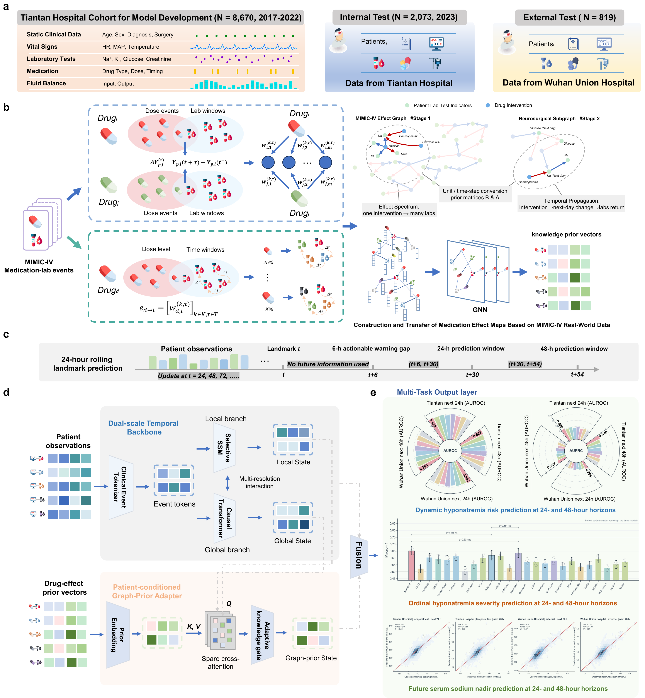
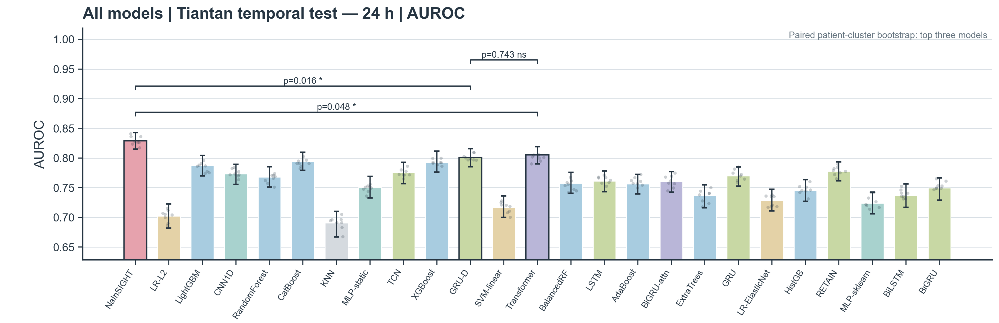
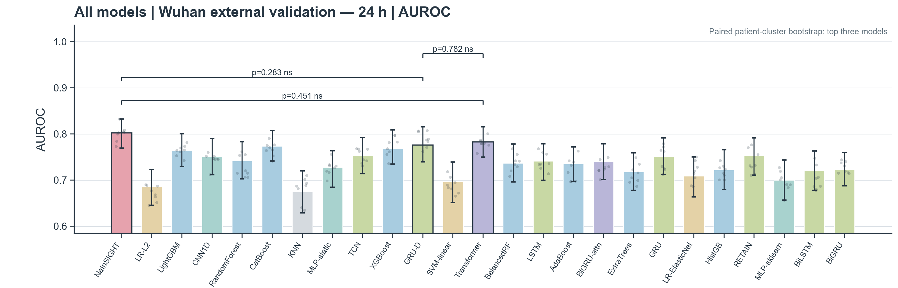
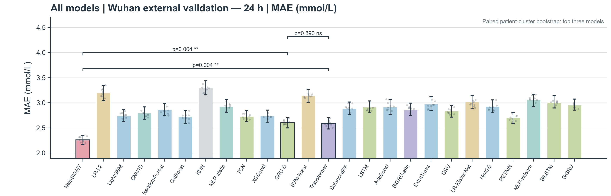
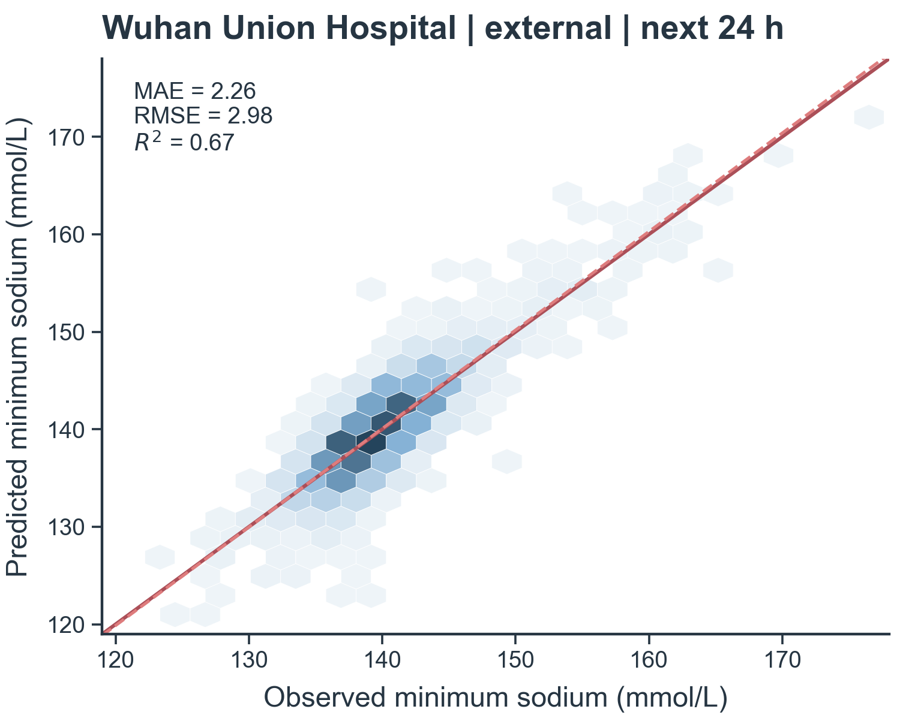
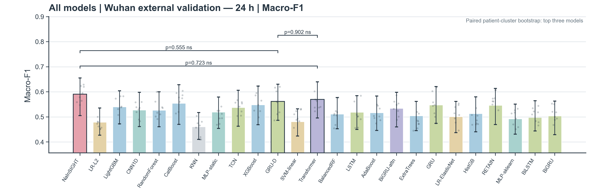
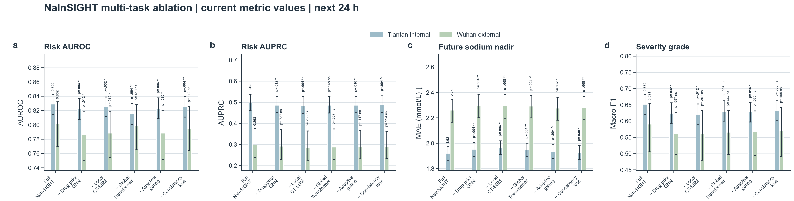
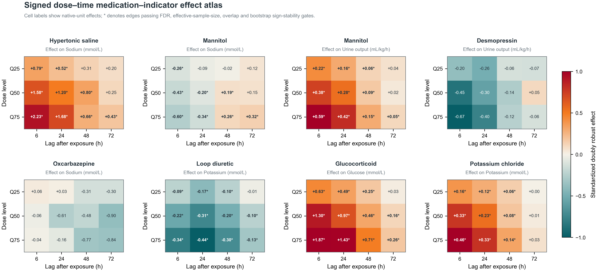
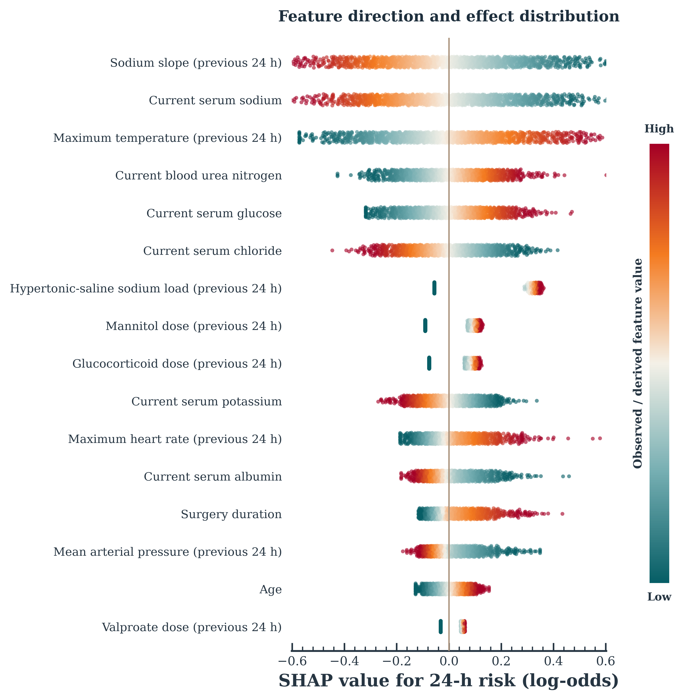

# NaInSIGHT

[](https://github.com/ZhWenPrism/NaInSIGHT/actions/workflows/ci.yml)

**Knowledge-guided dynamic prediction of postoperative hyponatraemia after glioma resection**

Developed in collaboration with **Beijing Tiantan Hospital**.

NaInSIGHT predicts postoperative hyponatraemia from routinely collected perioperative electronic health
record data. At the end of surgery and every 24 h thereafter, the model estimates the risk of
hyponatraemia (serum sodium < 135 mmol/L), its ordinal severity and the serum sodium nadir over the next
24 h and 48 h. Patient trajectories are encoded by **NaFormer**, a dual-scale temporal backbone that couples
a selective state-space branch with a causal Transformer. The trajectory representation is complemented by
a medication–laboratory effect graph estimated in an independent critical-care population and introduced
through a patient-conditioned graph-prior adapter.

## Contents

- [Framework](#framework)
- [Results overview](#results-overview)
- [Complete results gallery](docs/RESULTS_GALLERY.md)
- [Methods](#methods)
- [Methods-to-code reference](#methods-to-code-reference)
- [Installation](#installation)
- [Data access and configuration](#data-access-and-configuration)
- [Usage](#usage)
- [Outputs](#outputs)
- [Tests](#tests)
- [License](#license)

## Framework

<p align="center">
  
</p>

<p align="center"><em>NaInSIGHT integrates perioperative event trajectories, a transferred medication-laboratory effect graph and the dual-scale NaFormer backbone for coherent 24 h and 48 h prediction.</em></p>

The framework links four layers of the study: temporally separated development and validation cohorts;
dose- and lag-resolved medication-effect estimation; leakage-aware landmark construction; and multi-task
prediction through local state-space, global causal-attention and patient-conditioned graph-prior pathways.
The full-resolution source is available as a [vector PDF](docs/assets/framework/NaFormer-framework.pdf).

| Component | Description |
|---|---|
| Landmark design | Surgery-end baseline (windows (0, 24] and (0, 48] h) and rolling landmarks every 24 h with a 6-h actionable gap (windows (t + 6, t + 30] and (t + 6, t + 54] h). Laboratory results are time-stamped at reporting time. |
| Event representation | One causal token sequence per admission covering laboratory results, vital signs, fluid balance and executed medication administrations, with dose-normalised medication tokens and landmark query tokens. |
| Medication–laboratory effect graph | Dose- and lag-resolved effects of 26 intervention classes on eight physiological states, estimated by within-stay fixed-effects models in MIMIC-IV, refined for a neurosurgical subpopulation by empirical Bayes, converted to the units and time steps of the development data and embedded by a self-supervised edge-conditioned graph neural network. |
| NaFormer backbone | Selective state-space local branch with time-aware discretisation, causal Transformer global branch with elapsed-time attention bias, and causal multi-resolution interaction between the branches. |
| Graph-prior adapter | Exposure-conditioned prior embeddings, mechanistic projection of expected state changes, sparse cross-attention from the landmark state to the graph and an adaptive knowledge gate. |
| Multi-task output | Coherent heads for hyponatraemia risk, ordinal severity and sodium nadir at 24 h and 48 h. |

## Results overview

The evaluation follows the model's three linked outputs: dynamic hyponatraemia risk, future serum sodium
nadir and ordinal severity. Results are reported separately for the Tiantan temporal test cohort and the
Wuhan Union external cohort at 24 h and 48 h horizons. The panels below provide a compact view of the
validation chain; the [complete results gallery](docs/RESULTS_GALLERY.md) contains all 73 figures, including
the surgery-end baseline analyses, ROC and precision-recall curves, calibration, decision-curve analysis,
agreement plots, ablations and interpretation panels.

### Dynamic risk discrimination

NaInSIGHT is compared with linear, tree-based, convolutional, recurrent, Transformer and state-space
baselines under the same temporal and external evaluation settings. Patient-cluster bootstrap intervals
preserve the dependence between repeated landmarks contributed by the same patient.

<p align="center">
  
</p>

<p align="center"><em>Dynamic hyponatraemia risk discrimination in the Tiantan temporal test cohort at the 24 h horizon.</em></p>

<p align="center">
  
</p>

<p align="center"><em>External evaluation of 24 h dynamic risk discrimination in the Wuhan Union cohort.</em></p>

### Multi-task prediction

The regression and ordinal heads extend the risk estimate into clinically interpretable forecasts of the
future sodium nadir and severity category. Aggregate model comparisons are paired with observed-predicted
agreement to show both relative performance and the scale of individual prediction error.

<p align="center">
  
</p>

<p align="center"><em>External comparison of future serum sodium nadir prediction at the 24 h horizon.</em></p>

<p align="center">
  
</p>

<p align="center"><em>Observed-predicted agreement for the future serum sodium nadir in external validation.</em></p>

<p align="center">
  
</p>

<p align="center"><em>External evaluation of ordinal hyponatraemia severity prediction at the 24 h horizon.</em></p>

### Architecture and knowledge-prior analysis

Ablation experiments isolate the contribution of the medication-effect prior, the selective state-space
and causal Transformer branches, adaptive gating and cross-task consistency. The effect atlas and SHAP
panels then connect model performance to the temporal, physiological and treatment-related signals used by
the prediction system. These interpretation results describe learned associations rather than causal
treatment effects.

<p align="center">
  
</p>

<p align="center"><em>Multi-task ablation across internal temporal testing and external validation.</em></p>

<p align="center">
  
</p>

<p align="center"><em>Dose- and lag-resolved medication-indicator associations used to construct the transferred knowledge prior.</em></p>

<p align="center">
  
</p>

<p align="center"><em>Direction and distribution of global feature contributions for 24 h dynamic risk prediction.</em></p>

## Methods

The Methods are also provided as a standalone document in [docs/METHODS.md](docs/METHODS.md).

### Study design and data sources

NaInSIGHT was developed and validated in a retrospective study of adult patients undergoing glioma resection, using routinely collected perioperative electronic health record (EHR) data. The development cohort comprised surgical admissions at the development centre between 2017 and 2023; admissions from 2017 to 2022 were used for model development and admissions from 2023 formed a temporally independent test cohort. An external cohort from a second centre was processed with the same pipeline, with every preprocessing parameter fixed at the value estimated in the training subset of the development data. A medication–laboratory effect graph was estimated in an independent reference population of adult intensive care unit (ICU) stays from MIMIC-IV (version 3.1; hosp and icu modules), accessed under the PhysioNet credentialed data use agreement. Only aggregate effect estimates derived from the reference population were transferred to the prediction model; no patient-level reference data entered model training.

### Notation and time axis

For admission $`i`$, let $`T^{\mathrm{adm}}_i`$, $`T^{\mathrm{start}}_i`$, $`T^{\mathrm{end}}_i`$ and $`T^{\mathrm{dis}}_i`$ denote the times of admission, start of operation, end of operation and discharge. Every clinical event recorded at calendar time $`T`$ was placed on a common clock defined as hours since the end of the index operation,

```math
t=\frac{T-T^{\mathrm{end}}_i}{1\ \mathrm{h}},\qquad t^{\mathrm{start}}_i=-d_i,\qquad L_i=\frac{T^{\mathrm{dis}}_i-T^{\mathrm{end}}_i}{1\ \mathrm{h}},
```

where $`d_i`$ is the operation duration in hours and $`L_i`$ the postoperative length of stay. Laboratory results were placed at their reporting time (request time when the reporting time was missing), vital signs and fluid-balance entries at their charting time and medications at their execution time. Events were linked to an admission when recorded between 30 days before admission and the earlier of discharge and 336 h after surgery.

### Cohort construction

Eligibility was assessed for each admission in the institutional surgical registry linked to the EHR, in the following order: (1) admission in 2017–2023; (2) age of 18 years or older; (3) tumour resection documented in the operative record, with biopsy-only procedures excluded; (4) a plausible operative record, $`0.25\le d_i\le 24`$ h; (5) consistent timestamps, $`T^{\mathrm{start}}_i\ge T^{\mathrm{adm}}_i-24`$ h (admission is recorded as a calendar date) and $`T^{\mathrm{end}}_i\le T^{\mathrm{dis}}_i`$; (6) $`L_i\ge 78`$ h, the minimum stay that accommodates the first rolling landmark (24 h), the actionable gap (6 h) and a complete 48-h window; (7) no documented preoperative hyponatraemia, that is, no serum sodium below 135 mmol/L reported between 30 days before admission and the start of surgery; (8) at least one landmark with an ascertainable risk outcome at either horizon; and (9) at least one landmark with ascertainable risk outcomes at both horizons. Only the first eligible admission of each patient was retained. Admissions from 2017–2022 formed the development set and admissions from 2023 the temporal test set, from which patients contributing to the development set were removed. Within the development set, 10% of patients were assigned to a validation subset, sampled separately among patients with and without any positive landmark; the remaining development patients formed the training subset. The number of admissions and patients remaining after every step is written to the cohort flow table.

### Clinical event processing

#### Laboratory results

Laboratory items were mapped by name and analyser code to 16 canonical concepts (Table M1). Serum sodium measured by the central chemistry analyser and blood-gas sodium were kept as separate concepts; only the former defined outcomes. Values outside the plausibility ranges in Table M1 were treated as missing.

#### Vital signs and fluid balance

Vital signs were mapped to 10 concepts and fluid-balance entries to five concepts (Table M1). Mean arterial pressure was derived from simultaneous systolic and diastolic readings with systolic above diastolic pressure as $`\mathrm{MAP}=(\mathrm{SBP}+2\mathrm{DBP})/3`$. Observations were aggregated in 4-h bins on the surgical clock,

```math
\bar{x}_{i,c,\kappa}=\frac{1}{\lvert\mathcal{E}_{i,c,\kappa}\rvert}\sum_{e\in\mathcal{E}_{i,c,\kappa}}x_e,\qquad t_{i,c,\kappa}=\max_{e\in\mathcal{E}_{i,c,\kappa}}t_e,\qquad \mathcal{E}_{i,c,\kappa}=\left\lbrace e:\ \left\lfloor t_e/4\right\rfloor=\kappa\right\rbrace,
```

using the mean for vital signs and the sum for fluid balance. Each aggregate was time-stamped at its latest contributing observation, so that it became available only once all of its components had been recorded. Fluid-balance entries duplicated across nursing charts were removed before summation.

**Table M1 | Canonical clinical concepts.**

| Modality | Concept | Unit | Plausibility range | Graph state node |
|---|---|---|---|---|
| Laboratory | Serum sodium (chemistry analyser) | mmol/L | 100–180 | Sodium |
| Laboratory | Sodium (blood gas) | mmol/L | 100–180 | Sodium |
| Laboratory | Potassium | mmol/L | 1.5–9 | Potassium |
| Laboratory | Chloride | mmol/L | 60–150 | Chloride |
| Laboratory | Glucose | mmol/L | 1–50 | Glucose |
| Laboratory | Urea | mmol/L | 0.3–80 | Urea |
| Laboratory | Creatinine | μmol/L | 10–1,000 | Creatinine |
| Laboratory | Albumin | g/L | 10–70 | Albumin |
| Laboratory | Total carbon dioxide | mmol/L | 5–50 | – |
| Laboratory | Total calcium | mmol/L | 1–4 | – |
| Laboratory | Haemoglobin | g/L | 30–250 | – |
| Laboratory | White-cell count | 10⁹/L | 0.1–100 | – |
| Laboratory | Platelet count | 10⁹/L | 5–1,500 | – |
| Laboratory | Osmolality | mOsm/kg | 200–400 | – |
| Laboratory | Urine sodium | mmol/L | 5–400 | – |
| Laboratory | Urine specific gravity | – | 1.000–1.060 | – |
| Vital sign | Heart rate | min⁻¹ | 20–250 | – |
| Vital sign | Systolic blood pressure | mmHg | 50–260 | – |
| Vital sign | Diastolic blood pressure | mmHg | 20–160 | – |
| Vital sign | Mean arterial pressure (derived) | mmHg | 30–200 | – |
| Vital sign | Body temperature | °C | 32–43 | – |
| Vital sign | Respiratory rate | min⁻¹ | 4–60 | – |
| Vital sign | Peripheral oxygen saturation | % | 50–100 | – |
| Vital sign | Point-of-care glucose | mmol/L | 1–40 | – |
| Vital sign | Left pupil diameter | mm | 1–9 | – |
| Vital sign | Right pupil diameter | mm | 1–9 | – |
| Fluid balance | Urine output | mL | 0–8,000 | Urine output |
| Fluid balance | Fluid intake | mL | 0–8,000 | – |
| Fluid balance | Cerebrospinal-fluid drainage | mL | 0–3,000 | – |
| Fluid balance | Wound drainage | mL | 0–3,000 | – |
| Fluid balance | Gastrointestinal losses | mL | 0–4,000 | – |

Plausibility ranges for vital signs and fluid balance apply to individual entries before aggregation.

#### Medication administrations and dose normalisation

Executed administration records were used, time-stamped at the execution time (scheduled time when the execution time was missing); duplicated records were removed. Product names were mapped by ordered patterns to a vocabulary of 72 ingredients grouped into 26 intervention classes (Table M2), and topical, ophthalmic and other non-systemic formulations were excluded. Routes were mapped to intravenous, oral, nasogastric, intramuscular, subcutaneous, intrathecal or other. For sources providing only medication orders, administrations were generated from the order frequency as $`t_j=t^{\mathrm{order}}+j\Delta_f`$ for $`j=0,\ldots,\lfloor (t^{\mathrm{stop}}-t^{\mathrm{order}})/\Delta_f\rfloor`$, with a single administration for immediate or as-needed orders.

Each recorded dose $`v`$ in unit $`u`$ was converted to the canonical unit of its ingredient (Table M2) as $`q=v\cdot\phi(u,\ell)`$, where $`\ell`$ is the product label:

```math
\phi(u,\ell)=\begin{cases}
\pi_u/\pi^{\ast} & u\ \text{a mass unit}\\
c(\ell)/\pi^{\ast} & u=\mathrm{mL},\ \text{ingredient dosed by mass}\\
\omega(\ell)/\pi^{\ast} & u\ \text{a unit dose (tablet, capsule, vial)}\\
\iota(\ell) & u=\mathrm{mL},\ \text{ingredient dosed in international units}\\
1,\ 1000\ \text{or}\ V(\ell) & u=\mathrm{mL},\ \mathrm{L}\ \text{or a container},\ \text{crystalloid solutions}
\end{cases}
```

Here $`\pi_u`$ is the number of milligrams per unit $`u`$ (1,000 for grams, 1 for milligrams and $`10^{-3}`$ for micrograms), $`\pi^{\ast}`$ the number of milligrams per canonical unit of the ingredient, $`c(\ell)`$ the mass concentration (mg/mL) read from the label as $`M/V`$ for labels of the form "$`V`$ mL : $`M`$", "$`M`$ : $`V`$ mL" or "$`M`$ $`V`$ mL" and as $`10p`$ for a $`p`$% (w/v) label, $`\omega(\ell)`$ the strength per unit dose, $`\iota(\ell)`$ the international units per millilitre and $`V(\ell)`$ the labelled volume. Doses that were non-positive or could not be converted were kept missing and were never set to zero.

Crystalloid administrations were additionally characterised by their sodium load, $`\mathrm{Na}=q\cdot\eta`$ (mmol), with $`\eta=10p/58.44`$ mmol/mL for sodium chloride at $`p`$% (w/v) (defaults $`p=10`$ for concentrated sodium chloride and $`p=0.9`$ otherwise when the label carried no concentration) and $`\eta`$ equal to 0.154, 0.077, 0.154, 0.147, 0.130 and 0 mmol/mL for isotonic saline, 0.45% saline, glucose–saline, Ringer's solution, lactated Ringer's solution and sodium-free solutions, respectively. Sodium chloride solutions were assigned to the hypertonic ($`p\ge 1.5`$), isotonic ($`0.8\le p\lt 1.5`$) or hypotonic ($`p\lt 0.8`$) class. Glucocorticoid doses were also expressed as prednisone equivalents, $`q^{\mathrm{PE}}=q\cdot r_g`$, with $`r_g`$ equal to 0.25 for hydrocortisone, 1 for prednisone and prednisolone, 1.25 for methylprednisolone and 6.67 for dexamethasone and betamethasone.

Dose magnitude entered the model as a within-ingredient level. For ingredient $`g`$, the cut-points $`\chi_{g,1}\lt \chi_{g,2}\lt \chi_{g,3}`$ were the empirical quartiles of the positive doses in the training subset (a single level was used for ingredients with fewer than 20 doses), and

```math
k=\begin{cases}1+\left\lvert\left\lbrace j:\ \chi_{g,j}\le q\right\rbrace\right\rvert & q\ \text{observed}\\ 0 & q\ \text{missing},\end{cases}
```

so that no potency equivalence between different drugs was assumed.

**Table M2 | Intervention classes (intervention nodes of the effect graph) and ingredients.**

| Intervention class | Ingredients | Canonical dose unit |
|---|---|---|
| Mannitol | mannitol | g |
| Hypertonic saline | concentrated sodium chloride; sodium chloride ≥1.5%* | mL |
| Isotonic saline | sodium chloride 0.8–1.5%* | mL |
| Hypotonic saline | sodium chloride <0.8%* | mL |
| Balanced crystalloid | Ringer's solution, lactated Ringer's solution | mL |
| Glucose–saline | glucose–sodium chloride | mL |
| Sodium-free solutions | glucose solution, free water | mL |
| Albumin | human albumin | g |
| Dexamethasone | dexamethasone | mg |
| Other glucocorticoids | methylprednisolone, hydrocortisone, prednisone, prednisolone, betamethasone | mg |
| Loop diuretics | furosemide, torasemide, bumetanide | mg |
| Thiazide and thiazide-like diuretics | hydrochlorothiazide, indapamide, chlorthalidone, metolazone | mg |
| Potassium-sparing diuretics | spironolactone, eplerenone, amiloride, triamterene | mg |
| Desmopressin | desmopressin | μg |
| Vasopressin analogues | vasopressin, posterior pituitary extract, terlipressin | IU (terlipressin: mg) |
| Tolvaptan | tolvaptan | mg |
| Potassium chloride | potassium chloride | g |
| Carbamazepine | carbamazepine | mg |
| Oxcarbazepine | oxcarbazepine | mg |
| Valproate | valproate | mg |
| Levetiracetam | levetiracetam | mg |
| Other antiepileptic drugs | phenobarbital, phenytoin, lamotrigine, topiramate, lacosamide, zonisamide, perampanel, gabapentin, pregabalin | mg |
| Serotonergic antidepressants | sertraline, paroxetine, fluoxetine, citalopram, escitalopram, venlafaxine, duloxetine, mirtazapine | mg |
| Antipsychotics | olanzapine, quetiapine, risperidone, haloperidol | mg |
| Opioids | morphine, fentanyl, sufentanil, remifentanil, hydromorphone, oxycodone, tramadol, pethidine | mg |
| Proton-pump inhibitors | omeprazole, esomeprazole, pantoprazole, lansoprazole, rabeprazole | mg |

\* Sodium chloride solutions without a dedicated product name were assigned to a class according to their labelled concentration.

### Landmarks and outcomes

Predictions were issued at a surgery-end baseline landmark and at rolling landmarks. The landmark set of admission $`i`$ was

```math
\mathcal{T}_i=\left\lbrace 0\right\rbrace\ \cup\ \left\lbrace \tau\in\left\lbrace 24,48,\ldots,168\right\rbrace:\ \tau+\gamma+48\le L_i,\ \ \tau\lt t^{\ast}_i\right\rbrace,
```

where $`\gamma=6`$ h is the actionable gap of rolling landmarks and $`t^{\ast}_i`$ the reporting time of the first postoperative serum sodium below 135 mmol/L ($`t^{\ast}_i=\infty`$ if none). The baseline landmark ($`\tau=0`$, $`\gamma_0=0`$) always satisfied $`48\le L_i`$ by construction of the cohort. For landmark $`\tau`$ with gap $`\gamma_\tau`$ and horizon $`h\in\left\lbrace 24,48\right\rbrace`$ h, the prediction window was $`W_h(\tau)=(\tau+\gamma_\tau,\ \tau+\gamma_\tau+h]`$. With $`\mathcal{R}_h(\tau)`$ the set of serum sodium results reported within $`W_h(\tau)`$ and $`s_e`$ their values, the three outcomes were

```math
y^{\mathrm{risk}}_h(\tau)=\begin{cases}\mathbf{1}\left[\min_{e\in\mathcal{R}_h(\tau)}s_e\lt 135\right] & \lvert\mathcal{R}_h(\tau)\rvert\ge 1\\ \text{not ascertainable} & \text{otherwise}\end{cases}
```

```math
y^{\mathrm{nadir}}_h(\tau)=\min_{e\in\mathcal{R}_h(\tau)}s_e\quad\text{if}\quad \exists\, e\in\mathcal{R}_h(\tau):\ t_e\in\big(\tau+\gamma_\tau+24j,\ \tau+\gamma_\tau+24(j+1)\big]\quad \forall\, j\in\left\lbrace 0,\ldots,h/24-1\right\rbrace
```

```math
y^{\mathrm{sev}}_h(\tau)=\begin{cases}0\ (\text{normal}) & y^{\mathrm{nadir}}_h(\tau)\ge 135\\ 1\ (\text{mild}) & 130\le y^{\mathrm{nadir}}_h(\tau)\lt 135\\ 2\ (\text{moderate–severe}) & y^{\mathrm{nadir}}_h(\tau)\lt 130\end{cases}
```

with the nadir and severity not ascertainable when the coverage condition failed. An event in the first 24 h of a 48-h window therefore established the 48-h risk but not the 48-h nadir. Outcomes that were not ascertainable did not contribute to the loss or to the evaluation of that outcome.

### Predictor construction

#### Static predictors

Static predictors comprised age, sex, body mass index, smoking and alcohol use, comorbidities (hypertension, diabetes mellitus, epilepsy or antiepileptic treatment history, kidney, cardiac and liver disease and a history of tumours outside the central nervous system), tumour characteristics (volume, involvement of 13 anatomical regions, number of involved regions, deep midline involvement, multiregional and transtentorial extension, compartment, histological family, recurrence and repeat surgery), operation duration, intraoperative blood loss and preoperative length of stay, $`(T^{\mathrm{start}}_i-T^{\mathrm{adm}}_i)/24`$ h. Preoperative summaries were derived from events with $`t\lt t^{\mathrm{start}}_i`$: the last values of serum sodium, potassium, chloride, glucose, creatinine, urea, albumin, haemoglobin, white-cell count and platelet count; the lowest serum sodium; indicators of exposure to mannitol, glucocorticoids, any antiepileptic drug, oxcarbazepine, valproate, hypertonic saline, desmopressin and diuretics; and urine output per day, $`\sum_e U_e/\max(\Delta^{U}_i,24\ \mathrm{h})\times 24\ \mathrm{h}`$, where $`\Delta^{U}_i`$ is the time between the first and last preoperative urine entries.

#### Standardisation and encoding

Measured values were standardised per concept $`c`$ with robust statistics estimated in the training subset,

```math
\tilde{x}=\mathrm{clip}\left(\frac{x-\mathrm{med}_c}{s_c},\,-6,\,6\right),\qquad s_c=\frac{Q_{0.75,c}-Q_{0.25,c}}{1.349},
```

with the standard deviation (and then 1) replacing $`s_c`$ when the interquartile range was degenerate. For medications, $`x=\log(1+q)`$ with ingredient-specific statistics. Continuous static variables were median-imputed, standardised in the same way, clipped at $`\pm 8`$ and accompanied by a missingness indicator when missing values occurred in the training subset; binary variables were zero-imputed with a missingness indicator; categorical variables were one-hot encoded for levels observed at least 20 times plus an 'other' level, with missing values encoded as all zeros. All statistics were estimated in the training subset only and applied unchanged to the validation, temporal test and external data.

#### Event tokens

Each admission was represented by one time-ordered sequence of tokens. Every event $`e`$ was encoded as

```math
\mathbf{o}_e=\big(c_e,\ g_e,\ m_e,\ r_e,\ \varphi_e,\ k_e,\ \tilde{x}_e,\ \mu_e,\ t_e,\ \nu_e\big),\qquad \nu_e=\mathrm{asinh}\left(\mathrm{Na}_e/50\right),
```

where $`c_e`$ is the concept, $`g_e`$ the ingredient (medications only), $`m_e`$ the modality (laboratory, vital sign, fluid balance, medication or landmark query), $`r_e`$ the route, $`\varphi_e`$ the perioperative phase (preoperative for $`t_e\lt t^{\mathrm{start}}_i`$, intraoperative for $`t^{\mathrm{start}}_i\le t_e\le 0`$ and postoperative for $`t_e\gt 0`$), $`k_e`$ the dose level, $`\tilde{x}_e`$ the standardised value, $`\mu_e\in\left\lbrace 0,1\right\rbrace`$ indicates whether a value is present, $`t_e`$ the event time and $`\mathrm{Na}_e`$ the sodium load in mmol. Concepts observed fewer than 20 times in the training subset were mapped to an unknown token. The sequence contained the events with $`t^{\mathrm{start}}_i-168\le t_e\le \max\mathcal{T}_i`$, ordered by time. For every landmark $`\tau\in\mathcal{T}_i`$, a landmark query token (baseline or rolling) with time $`\tau`$ was inserted after all events with $`t_e\le\tau`$; predictions for $`\tau`$ were read from the hidden state of this token. Sequences longer than 1,024 tokens were truncated by removing the earliest events, and query tokens were always retained.

#### Knowledge-graph exposure profile

At each landmark $`\tau`$, a 16-dimensional exposure profile $`\mathbf{f}_n(\tau)`$ was computed for every graph node $`n`$ from information available at $`\tau`$. For an intervention node $`d`$, with $`\mathcal{A}_d(a,b]`$ the administrations of class $`d`$ in $`(a,b]`$,

```math
\begin{aligned}
f_{d,1:3}&=\Big(\mathbf{1}\big[\mathcal{A}_d(\tau-w,\tau]\neq\varnothing\big)\Big)_{w\in\lbrace 6,24,72\rbrace},\qquad
f_{d,4:8}=\mathrm{onehot}_{0,\ldots,4}\Big(\max_{a\in\mathcal{A}_d(\tau-24,\tau]}k_a\Big),\\
f_{d,9}&=\frac{\log\big(1+\tau-t^{\mathrm{last}}_d\big)}{\log 169},\qquad
f_{d,10}=\frac{\log\big(1+\lvert\mathcal{A}_d(\tau-24,\tau]\rvert\big)}{\log 10},\qquad
f_{d,11}=\mathrm{asinh}\Big(\frac{1}{100}\sum_{a\in\mathcal{A}_d(\tau-24,\tau]}\mathrm{Na}_a\Big),
\end{aligned}
```

where $`t^{\mathrm{last}}_d`$ is the time of the last administration ($`f_{d,9}=1`$ if the class had never been given) and the dose one-hot includes level 0 for administrations with an unknown dose. For a laboratory state node $`l`$, $`f_{l,12}`$ is the last standardised value, $`f_{l,13}`$ indicates that the state had been measured, $`f_{l,14}`$ is the difference between the last two standardised values, $`f_{l,15}`$ is the recency defined as for $`f_{d,9}`$ and $`f_{l,16}=\log(1+n_{l,24})/\log 10`$, with $`n_{l,24}`$ the number of measurements in the preceding 24 h. For urine output, with $`U_{(a,b]}`$ the urine volume charted in $`(a,b]`$,

```math
f_{U,12}=\mathrm{clip}\left(\frac{U_{(\tau-24,\tau]}-m_U}{s_U},\pm 6\right),\qquad f_{U,14}=\mathrm{clip}\left(\frac{U_{(\tau-24,\tau]}-U_{(\tau-48,\tau-24]}}{s_U},\pm 6\right),
```

where $`m_U`$ and $`s_U=\max(\mathrm{IQR}_U/1.349,\ 100\ \mathrm{mL})`$ are the median and robust spread of daily urine totals in the training subset, and $`f_{U,13}`$ indicates any urine entry in the preceding 24 h. All remaining entries were zero.

### Medication–laboratory effect graph

#### Reference population and anchor design

Adult ICU stays of at least 24 h were included, with age computed from the anchor age and year of the reference database. Within each stay, time was measured in hours since ICU admission and anchors were placed at $`a_j=6j`$, $`j=1,\ldots,\lfloor (L^{\mathrm{ICU}}-6)/6\rfloor`$. Administrations (medication administration records documented as administered, with the administered dose) and infusions (ICU input events) were normalised to the canonical units of Table M2. The amount of an infusion running from $`t^{\mathrm{s}}`$ to $`t^{\mathrm{e}}`$ was attributed to the 6-h windows it overlapped in proportion to the overlap,

```math
q_{w}=q\ \frac{\big\lvert\,[t^{\mathrm{s}},t^{\mathrm{e}}]\cap[6w,\,6w+6)\,\big\rvert}{t^{\mathrm{e}}-t^{\mathrm{s}}}.
```

Infusions of zero duration were attributed to the window containing them. Dose levels were within-ingredient quartiles of administered doses and within-class quartiles of 6-h infusion amounts, administrations without a recorded dose being assigned level 2. The exposure indicator $`x_{a,d,k}`$ equalled 1 when the highest level of class $`d`$ in the exposure window $`[a,a+6)`$ was $`k`$. For each of eight state nodes $`l`$ (serum sodium, potassium, chloride, glucose, urea, creatinine, albumin and urine output) and lag $`\tau\in\left\lbrace 6,12,24,48\right\rbrace`$ h, the baseline and follow-up values were

```math
Y_l(a^{-})=Y_l(t^{-}),\ \ t^{-}=\max\left\lbrace t_e:\ a-24\le t_e\le a\right\rbrace;\qquad
Y_l(a+\tau)=Y_l(t^{+}),\ \ t^{+}=\arg\min_{t_e\gt a,\ \lvert t_e-a-\tau\rvert\le\max(2,\,0.25\tau)}\lvert t_e-a-\tau\rvert,
```

and $`\Delta Y^{(\tau)}_{a,l}=Y_l(a+\tau)-Y_l(a^{-})`$. For urine output, $`Y(a^{-})`$ and $`Y(a+\tau)`$ were the hourly output rates over $`[a-6,a)`$ and $`[a+\tau-6,a+\tau)`$.

#### Effect estimation

For every state $`l`$ and lag $`\tau`$, a within-stay fixed-effects linear model was fitted,

```math
\Delta Y^{(\tau)}_{a,l}=\sum_{d=1}^{26}\sum_{k=1}^{4}\beta^{(k,\tau)}_{d,l}\,x_{a,d,k}+\sum_{m=1}^{8}\alpha^{(\tau)}_{l,m}\,z_{a,m}+\sum_{m=1}^{8}\gamma_m\,\rho_{a,m}+u_{s(a)}+\varepsilon_a,
```

where $`z_{a,m}=(Y_m(a^{-})-\bar{Y}_m)/\mathrm{sd}_m`$ is the baseline of state $`m`$ standardised over the anchors of the population being analysed (set to zero when missing, with indicator $`\rho_{a,m}`$) and $`u_{s(a)}`$ is the fixed effect of stay $`s(a)`$. The self term $`\alpha_{l,l}`$ captures regression towards the mean and the cross terms capture propagation between states. With $`\ddot{X}`$ and $`\ddot{\mathbf{y}}`$ the design matrix and outcome after within-stay demeaning (stays with a single anchor removed), $`n`$ the number of anchors and $`\lambda=10^{-6}`$,

```math
\hat{\boldsymbol{\theta}}=M^{-1}\ddot{X}^{\top}\ddot{\mathbf{y}},\qquad M=\ddot{X}^{\top}\ddot{X}+\lambda n I,\qquad
\widehat{V}(\hat{\boldsymbol{\theta}})=\frac{G}{G-1}\,M^{-1}\Big(\sum_{g=1}^{G}\mathbf{s}_g\mathbf{s}_g^{\top}\Big)M^{-1},\qquad \mathbf{s}_g=\sum_{a\in g}\ddot{\mathbf{x}}_a\hat{\varepsilon}_a,
```

where $`g=1,\ldots,G`$ indexes patients. Coefficients supported by fewer than 30 exposed anchors were set to missing, at most 600,000 anchors (sampled as whole stays) entered each regression, and models with fewer than 200 usable anchors were not fitted. The effect spectrum of intervention $`d`$ on state $`l`$ is $`\mathbf{e}_{d\to l}=\big[\beta^{(k,\tau)}_{d,l}\big]_{k,\tau}\in\mathbb{R}^{4\times 4}`$.

#### Neurosurgical subgraph

The same models were estimated in the subpopulation of admissions with an intracranial neoplasm diagnosis (ICD-10 C71, D33, D43 or C79.31; ICD-9 191, 225.0, 237.5 or 198.3) or an intracranial excision procedure (ICD-10-PCS root operations 00B or 00C on central nervous system body parts; ICD-9-CM 01.2 or 01.5). Subpopulation ($`\mathrm{n}`$) and full-population ($`\mathrm{a}`$) estimates were combined by empirical Bayes precision weighting,

```math
\hat{\beta}=\frac{w_{\mathrm{n}}\beta_{\mathrm{n}}+w_{\mathrm{a}}\beta_{\mathrm{a}}}{w_{\mathrm{n}}+w_{\mathrm{a}}},\qquad w_{\mathrm{n}}=\mathrm{SE}_{\mathrm{n}}^{-2},\qquad w_{\mathrm{a}}=\left(\mathrm{SE}_{\mathrm{a}}^{2}+\hat{\tau}^{2}\right)^{-1},\qquad \widehat{\mathrm{SE}}=\left(w_{\mathrm{n}}+w_{\mathrm{a}}\right)^{-1/2},
```

```math
\hat{\tau}^{2}=\max\left\lbrace 0,\ \frac{1}{\lvert\mathcal{P}\rvert}\sum_{p\in\mathcal{P}}\left[\left(\beta_{\mathrm{n},p}-\beta_{\mathrm{a},p}\right)^{2}-\mathrm{SE}_{\mathrm{n},p}^{2}-\mathrm{SE}_{\mathrm{a},p}^{2}\right]\right\rbrace,
```

where $`\mathcal{P}`$ contains the coefficients of the same type (intervention or state) for the same state and lag that were estimable in both populations ($`\hat{\tau}^{2}=0`$ when $`\lvert\mathcal{P}\rvert\lt 3`$), and $`w_{\mathrm{n}}=0`$ when no subpopulation estimate was available.

#### Transfer to the development cohort

Effects and standard errors were converted to the units of the development data by state-specific factors $`\psi_l`$ (glucose 0.0555, mg/dL to mmol/L; urea nitrogen 0.357, mg/dL to mmol/L of urea; creatinine 88.4, mg/dL to μmol/L; albumin 10, g/dL to g/L; urine output 24, mL/h to mL per 24 h; 1 otherwise). Spectra were then mapped from the reference lags to the time steps of the development landmarks,

```math
\beta^{(k,\tau')}_{d,l}=\mathrm{interp}\left(\tau';\ \left\lbrace\left(\tau,\ \psi_l\,\beta^{(k,\tau)}_{d,l}\right):\ \tau\in\left\lbrace 6,12,24,48\right\rbrace,\ \beta^{(k,\tau)}_{d,l}\ \text{estimable}\right\rbrace\right),\qquad \tau'\in\left\lbrace 6,12,24,30,48,54\right\rbrace,
```

by piecewise-linear interpolation that is constant beyond the outermost estimable lags, and analogously for $`\alpha`$. This produced the intervention-effect tensor $`\mathbf{B}\in\mathbb{R}^{26\times 4\times 6\times 8}`$ with $`B_{d,k,\tau',l}=\beta^{(k,\tau')}_{d,l}`$ and the state-propagation tensor $`\mathbf{A}\in\mathbb{R}^{6\times 8\times 8}`$ with $`A_{\tau',l,m}=\alpha^{(\tau')}_{l,m}`$.

#### Graph assembly

The graph contained 34 nodes: 26 intervention nodes and eight state nodes. An intervention $`d`$ was connected to a state $`l`$ whenever at least one coefficient was estimable. With $`Z^{(k,\tau)}_{d,l}=\mathrm{clip}(\beta^{(k,\tau)}_{d,l}/\mathrm{SE}^{(k,\tau)}_{d,l},\pm 10)`$ (zero when missing), $`w=\mathrm{SE}^{-2}`$, the pooled effect $`\bar{\beta}_{d,l}=\sum w\beta/\sum w`$ and its z-statistic $`\bar{z}_{d,l}=\bar{\beta}_{d,l}\sqrt{\sum w}`$, the edge attribute was

```math
\mathbf{a}_{d\to l}=\left[\tfrac{1}{10}\mathrm{vec}\left(Z_{d,l}\right),\ \ \varrho_{d,l},\ \ \mathrm{sign}\left(\bar{\beta}_{d,l}\right),\ \ \tfrac{1}{10}\max_{k,\tau}\left\lvert Z^{(k,\tau)}_{d,l}\right\rvert,\ \ \tanh\left(\bar{\beta}_{d,l}/\sigma_l\right)\right]\in\mathbb{R}^{20},
```

where $`\varrho_{d,l}`$ is the fraction of estimable coefficients and $`\sigma_l`$ the baseline standard deviation of state $`l`$ in the reference population (development units). Reverse edges $`l\to d`$ carried the same attribute as a separate edge type, and state edges $`m\to l`$ carried the propagation z-statistics over lags with the same four summaries. Each intervention-to-state edge was labelled as decreasing ($`\bar{z}_{d,l}\lt -1.96`$), increasing ($`\bar{z}_{d,l}\gt 1.96`$) or without a clear effect. Node features comprised the node type, the square root of the exposure prevalence and the mean absolute z-statistic for interventions, and the standardised baseline mean and logarithm of the baseline standard deviation for states. The reliability $`\varrho_n`$ of a node was the fraction of its effect estimates with $`\lvert z\rvert\gt 1.96`$.

#### Graph neural network pre-training

Knowledge prior vectors were learned with an edge-conditioned message-passing network,

```math
\begin{aligned}
\mathbf{h}^{(0)}_v&=\mathrm{MLP}_{\mathrm{in}}(\mathbf{x}_v)+\mathbf{E}^{\mathrm{node}}_v,\qquad
\mathbf{e}_{uv}=W_e\,[\mathbf{a}_{uv};\epsilon_{uv}]+\mathbf{E}^{\mathrm{type}}_{uv},\\
\mathbf{m}_{u\to v}&=\mathrm{MLP}_m\left([\mathbf{h}_v;\mathbf{h}_u;\mathbf{e}_{uv}]\right)\odot\sigma\left(W_g[\mathbf{h}_v;\mathbf{h}_u;\mathbf{e}_{uv}]\right),\\
\mathbf{h}^{(\ell+1)}_v&=\mathrm{LN}\Big(\mathbf{h}^{(\ell)}_v+\mathrm{MLP}_u\Big[\mathbf{h}^{(\ell)}_v;\ \frac{1}{\max(1,\deg^{-}(v))}\sum_{u\to v}\mathbf{m}_{u\to v}\Big]\Big),\qquad
\mathbf{p}_v=\mathrm{LN}\left(W_o\mathbf{h}^{(3)}_v\right)\in\mathbb{R}^{64},
\end{aligned}
```

with three layers of width 128, dropout 0.1 and $`\epsilon_{uv}`$ a flag marking masked edge attributes. Three self-supervised objectives were defined on the set $`\mathcal{E}`$ of intervention-to-state edges:

```math
\mathcal{L}_{\mathrm{GNN}}=\frac{1}{20\lvert\mathcal{M}\rvert}\sum_{(u,v)\in\mathcal{M}}\left\lVert D_{\mathrm{rec}}(\mathbf{p}_u,\mathbf{p}_v)-\mathbf{a}_{uv}\right\rVert_2^2
-0.5\,\frac{\sum_{e\in\mathcal{E}}w_{y_e}\log\pi_{e,y_e}}{\sum_{e\in\mathcal{E}}w_{y_e}}
-\frac{0.5}{2\lvert\mathcal{E}\rvert}\sum_{(u,v)\in\mathcal{E}}\left[\log\sigma\left(\varsigma_{uv}\right)+\log\left(1-\sigma\left(\varsigma'_{uv}\right)\right)\right],
```

where $`\mathcal{M}`$ is a random 15% of $`\mathcal{E}`$ whose attributes (and those of their reverse edges) were replaced by zeros with $`\epsilon_{uv}=1`$ at each step; $`D_{\mathrm{rec}}`$ reconstructs the attribute from $`[\mathbf{p}_u;\mathbf{p}_v;\mathbf{p}_u\odot\mathbf{p}_v]`$; $`\pi_{e}`$ are the softmax probabilities of the effect-direction classifier on the same input with class weights $`w_c=\lvert\mathcal{E}\rvert/(3N_c)`$; and $`\varsigma_{uv}`$ and $`\varsigma'_{uv}`$ are the scores of an edge-consistency discriminator applied to $`[\mathbf{p}_u;\mathbf{p}_v;\mathbf{a}_{uv}]`$ and to the same pair with the attribute of a randomly permuted edge. Training used AdamW (learning rate $`10^{-3}`$, weight decay $`10^{-4}`$) for 600 full-graph epochs with gradient clipping at 1.0. The vectors $`\mathbf{p}_v`$ computed on the unmasked graph were used as knowledge prior vectors and kept fixed during training of the prediction model.

### Temporal prediction model

#### Event embedding

Each token was embedded in $`\mathbb{R}^{128}`$ as

```math
\mathbf{x}_e=\mathrm{LN}\Big(\mathbf{E}^{c}_{c_e}+\mathbf{E}^{g}_{g_e}+\mathbf{E}^{m}_{m_e}+\mathbf{E}^{r}_{r_e}+\mathbf{E}^{\varphi}_{\varphi_e}+\mathbf{E}^{k}_{k_e}+\mathbf{v}_e+W_t\left[\mathrm{T2V}_{24}(t_e);\ \mathrm{T2V}_{6}\left(\log(1+\delta_e)\right)\right]+\mathbf{w}_\nu\nu_e+\mathbf{b}_\nu\Big),
```

```math
\mathbf{v}_e=\mathrm{MLP}_v\left([\tilde{x}_e,\mu_e]\right)\odot\left(1+\boldsymbol{\gamma}\left(\mathbf{E}^{c}_{c_e}\right)\right)+\boldsymbol{\beta}\left(\mathbf{E}^{c}_{c_e}\right),\qquad
\mathrm{T2V}_{s}(t)=\left[\omega_0\frac{t}{s}+\phi_0,\ \ \sin\left(\omega_j\frac{t}{s}+\phi_j\right)_{j=1}^{63}\right],
```

where $`\delta_e=t_e-t_{e-1}\ge 0`$ is the time since the preceding token, $`\boldsymbol{\gamma}`$ and $`\boldsymbol{\beta}`$ are linear maps initialised at zero (feature-wise linear modulation of the value by its concept) and the Time2Vec frequencies $`\omega_j`$ were initialised at log-spaced values between 0.15 and 6.0. Dropout of 0.1 was applied and padded positions were set to zero.

#### Selective state-space branch

The local branch consisted of pre-normalised residual blocks $`\mathbf{h}\leftarrow\mathbf{h}+\mathrm{Dropout}(\mathrm{SSM}(\mathrm{LN}(\mathbf{h})))`$. For token $`t`$ and head $`j`$ ($`j=1,\ldots,8`$; head width 32; inner width 256; state size 16),

```math
\begin{aligned}
[\mathbf{z}_t;\ \mathbf{u}_t;\ \mathbf{b}_t;\ \mathbf{c}_t;\ \boldsymbol{\eta}_t]&=W_{\mathrm{in}}\mathbf{h}_t,\qquad
[\mathbf{x}_t;\ B_t;\ C_t]=\mathrm{SiLU}\left(\mathrm{CausalConv}_{4}\left([\mathbf{u};\mathbf{b};\mathbf{c}]\right)_t\right),\\
\Delta_{t,j}&=\mathrm{softplus}\left(\eta_{t,j}+b_j\right)\left(1+\mathrm{softplus}(\varpi_j)\log(1+\delta_t)\right),\\
\mathbf{S}_{t,j}&=\exp\left(\Delta_{t,j}A_j\right)\mathbf{S}_{t-1,j}+\Delta_{t,j}\,\mathbf{x}_{t,j}B_t^{\top},\qquad
\mathbf{y}_{t,j}=\mathbf{S}_{t,j}C_t+D_j\mathbf{x}_{t,j},\\
\mathrm{SSM}(\mathbf{h})_t&=W_{\mathrm{out}}\,\mathrm{RMSNorm}\left(\mathbf{y}_t\odot\mathrm{SiLU}(\mathbf{z}_t)\right),
\end{aligned}
```

with $`A_j=-\exp(a_j)`$, $`a_j`$ initialised as the logarithm of a draw from $`U(1,16)`$, $`b_j`$ initialised so that $`\mathrm{softplus}(b_j)`$ is log-uniform on $`[10^{-3},10^{-1}]`$, $`\varpi_j=0`$ and $`D_j=1`$ at initialisation. The step size grows with the elapsed time $`\delta_t`$ since the preceding event, so that the retained state reflects irregular sampling; padded positions have $`\Delta=0`$ and neither decay nor update the state. The recurrence was evaluated exactly in its equivalent form

```math
\mathbf{y}_{t,j}=\sum_{s\le t}\left(C_t^{\top}B_s\right)\exp\Big(A_j\sum_{r=s+1}^{t}\Delta_{r,j}\Big)\Delta_{s,j}\,\mathbf{x}_{s,j}+D_j\mathbf{x}_{t,j},
```

computed within chunks of 64 tokens and propagated across chunk boundaries through the recurrent state.

#### Causal Transformer branch

The global branch consisted of pre-normalised Transformer blocks, $`\mathbf{h}\leftarrow\mathbf{h}+\mathrm{Dropout}(\mathrm{MHA}(\mathrm{LN}(\mathbf{h})))`$ followed by $`\mathbf{h}\leftarrow\mathbf{h}+\mathrm{Dropout}(\mathrm{FFN}(\mathrm{LN}(\mathbf{h})))`$, with four heads of width 32 and a feed-forward network of width 512. Attention combined causal masking with a learned bias over elapsed time,

```math
\mathrm{Attn}_j(i,i')=\mathrm{softmax}_{i'}\left(\frac{\mathbf{q}_{i,j}^{\top}\mathbf{k}_{i',j}}{\sqrt{32}}+\omega_{j,\,b(\lvert t_i-t_{i'}\rvert)}+M_{ii'}\right),\qquad
M_{ii'}=\begin{cases}0 & i'\le i\ \text{and}\ i'\ \text{is an observed token}\\ -\infty & \text{otherwise,}\end{cases}
```

where $`b(\cdot)`$ assigns the elapsed time to one of 12 buckets with boundaries at 1, 2, 4, 8, 12, 24, 48, 72, 120, 168 and 336 h and $`\omega_{j,b}`$ (initialised at zero) is shared by the two stages.

#### Causal multi-resolution interaction

After each stage, the branches exchanged information through time bins aligned to the surgical clock. For resolution $`\rho`$, tokens were assigned to bins $`b_\rho(t)=\lfloor (t-t_0)/\rho\rfloor`$ with $`t_0=\rho\lfloor \min_e t_e/\rho\rfloor`$, and each branch was summarised per bin as $`\bar{\mathbf{h}}^{(\rho)}_\kappa=\lvert\mathcal{B}_\kappa\rvert^{-1}\sum_{e\in\mathcal{B}_\kappa}\mathbf{h}_e`$, $`\mathcal{B}_\kappa=\left\lbrace e:\ b_\rho(t_e)=\kappa\right\rbrace`$. A token attended only to non-empty bins completed before its own bin:

```math
\mathrm{CBA}_\rho\left(\mathbf{H}^{\mathrm{q}},\mathbf{H}^{\mathrm{s}}\right)_i=W_o\mathrm{concat}_{j}\ \sum_{\kappa\lt b_\rho(t_i)}\mathrm{softmax}_{\kappa}\left(\frac{\left(W_q\mathrm{LN}\,\mathbf{h}^{\mathrm{q}}_i\right)_j^{\top}\left(W_k\mathrm{LN}\,\bar{\mathbf{h}}^{\mathrm{s},(\rho)}_\kappa\right)_j}{\sqrt{32}}\right)\left(W_v\mathrm{LN}\,\bar{\mathbf{h}}^{\mathrm{s},(\rho)}_\kappa\right)_j,
```

which is zero when no completed bin exists. The local branch read 24-h summaries of the global branch and the global branch read 6-h summaries of the local branch, with gated residual updates computed from the states before the exchange,

```math
\mathbf{H}^{\mathrm{loc}}\leftarrow\mathbf{H}^{\mathrm{loc}}+\sigma\left(\boldsymbol{\lambda}_{\mathrm{loc}}\right)\odot\mathrm{CBA}_{24}\left(\mathbf{H}^{\mathrm{loc}},\mathbf{H}^{\mathrm{glob}}\right),\qquad
\mathbf{H}^{\mathrm{glob}}\leftarrow\mathbf{H}^{\mathrm{glob}}+\sigma\left(\boldsymbol{\lambda}_{\mathrm{glob}}\right)\odot\mathrm{CBA}_{6}\left(\mathbf{H}^{\mathrm{glob}},\mathbf{H}^{\mathrm{loc}}\right),
```

where $`\boldsymbol{\lambda}`$ were initialised at $`-2`$. Each of the two stages applied a state-space block, a Transformer block and the interaction in this order. The two branches were merged as $`\mathbf{z}_e=\mathrm{LN}(W_{\mathrm{mrg}}[\mathbf{h}^{\mathrm{loc}}_e;\mathbf{h}^{\mathrm{glob}}_e])`$, and the landmark state $`\mathbf{z}_\tau`$ was the merged state of the query token of landmark $`\tau`$. All operations are causal in token order, so that no event reported after a landmark can influence its prediction.

#### Patient-conditioned graph-prior adapter

A mechanistic projection of the expected change of each state at each development lag was computed from the transferred effects and the exposure profile,

```math
\Delta\hat{Y}_{\tau',l}=\frac{c_l}{\sigma^{\mathrm{dev}}_l}\left(\sum_{d,k}B_{d,k,\tau',l}\,\tilde{e}_{d,k}+\sum_{m}A_{\tau',l,m}\,\bar{z}_m\right),
```

where $`\tilde{e}_{d,k}=f_{d,4+k}`$ for $`k=1,\ldots,4`$ with the unknown-dose indicator $`f_{d,4}`$ added to level 2, $`\bar{z}_m=f_{m,12}f_{m,13}`$, $`\sigma^{\mathrm{dev}}_l`$ is the robust spread of state $`l`$ in the training subset ($`s_U`$ for urine output), $`c_l`$ is a learned calibration factor initialised at 1, and missing effects are set to zero. The prior vectors were embedded and conditioned on the patient,

```math
\mathbf{u}^{0}_n=\mathrm{LN}\left(\mathrm{MLP}_p(\mathbf{p}_n)+\mathbf{E}^{\mathrm{type}}_n+\mathbf{E}^{\mathrm{id}}_n\right),\qquad
[\boldsymbol{\gamma}_n;\boldsymbol{\beta}_n]=\mathrm{MLP}_f\left([\mathbf{f}_n(\tau);\ \Delta\hat{\mathbf{Y}}_{\cdot,n}]\right),\qquad
\mathbf{u}_n=\mathbf{u}^{0}_n\odot(1+\boldsymbol{\gamma}_n)+\boldsymbol{\beta}_n,
```

where $`\Delta\hat{\mathbf{Y}}_{\cdot,n}\in\mathbb{R}^{6}`$ is the projection for state nodes and zero for intervention nodes, and the last layer of $`\mathrm{MLP}_f`$ was initialised at zero. The landmark state attended to the 34 conditioned node embeddings with four heads, retaining only the eight largest logits per head:

```math
\ell_{j,n}=\frac{\left(W_q\mathrm{LN}\,\mathbf{z}_\tau\right)_j^{\top}\left(W_k\mathbf{u}_n\right)_j}{\sqrt{32}},\qquad
\pi_{j,n}=\frac{\exp(\ell_{j,n})\,\mathbf{1}\left[\ell_{j,n}\ge\ell_{j,(8)}\right]}{\sum_{n'}\exp(\ell_{j,n'})\,\mathbf{1}\left[\ell_{j,n'}\ge\ell_{j,(8)}\right]},\qquad
\mathbf{c}_\tau=W_o\mathrm{concat}_{j}\sum_{n}\pi_{j,n}\left(W_v\mathbf{u}_n\right)_j,
```

where $`\ell_{j,(8)}`$ is the eighth-largest logit of head $`j`$. An adaptive knowledge gate controlled the contribution of the prior,

```math
r_\tau=\sum_n\bar{\pi}_n\varrho_n,\qquad \bar{\pi}_n=\frac{1}{4}\sum_j\pi_{j,n},\qquad
\mathbf{g}_\tau=\sigma\left(\mathrm{MLP}_g[\mathbf{z}_\tau;\mathbf{c}_\tau;r_\tau]\right),\qquad
\mathbf{s}_\tau=\mathbf{g}_\tau\odot\mathbf{c}_\tau,
```

where $`\varrho_n`$ is the node reliability and the output bias of $`\mathrm{MLP}_g`$ was initialised at $`-1`$. The knowledge prior vectors were not updated during training.

#### Fusion and coherent multi-task output

The landmark representation was

```math
\mathbf{o}_\tau=\mathrm{MLP}_{\mathrm{head}}\left(\mathrm{MLP}_{\mathrm{fuse}}\left(\mathrm{LN}\left[\mathbf{z}_\tau;\ \mathbf{s}_\tau;\ \mathrm{MLP}_{\mathrm{st}}\left(\tilde{\mathbf{x}}^{\mathrm{static}}_i\right);\ \mathbf{E}^{\mathrm{mode}}_\tau;\ \mathrm{T2V}_{24}(\tau)\right]\right)\right),
```

where $`\mathrm{MLP}_{\mathrm{st}}`$ maps the static predictors to 128 dimensions, $`\mathbf{E}^{\mathrm{mode}}`$ embeds the prediction mode (baseline or rolling), $`\mathrm{MLP}_{\mathrm{fuse}}`$ has two layers of width 256 and $`\mathrm{MLP}_{\mathrm{head}}`$ two layers of width 128. The outputs were parameterised to be mutually coherent across tasks and nested windows:

```math
\eta_{24}=\mathbf{w}_r^{\top}\mathbf{o}_\tau+b_r,\qquad \eta_{48}=\eta_{24}+\mathrm{softplus}\left(\mathbf{w}_{\Delta r}^{\top}\mathbf{o}_\tau+b_{\Delta r}\right),\qquad \hat{p}^{\mathrm{risk}}_h=\sigma(\eta_h),
```

```math
P\left(y^{\mathrm{sev}}_h\ge 1\right)=\sigma(\eta_h),\qquad P\left(y^{\mathrm{sev}}_h\ge 2\right)=\sigma\left(\vartheta_h\right),\qquad \vartheta_h=\eta_h-\mathrm{softplus}\left(\mathbf{w}_{s,h}^{\top}\mathbf{o}_\tau+b_{s,h}\right)-0.5,
```

```math
\mu_{24}=\mathrm{Na}^{\mathrm{ref}}_\tau+\mathbf{w}_\mu^{\top}\mathbf{o}_\tau+b_\mu,\qquad \mu_{48}=\mu_{24}-\mathrm{softplus}\left(\mathbf{w}_{\Delta\mu}^{\top}\mathbf{o}_\tau+b_{\Delta\mu}\right),\qquad \sigma_h=\mathrm{softplus}\left(\mathbf{w}_{\sigma,h}^{\top}\mathbf{o}_\tau+b_{\sigma,h}\right)+0.5,
```

where $`\mathrm{Na}^{\mathrm{ref}}_\tau`$ is the last sodium value (chemistry or blood gas) reported at or before $`\tau`$, or a learned constant initialised at 140 mmol/L when none was available. The predicted 48-h risk therefore cannot be lower than the 24-h risk, the probability of any hyponatraemia equals the probability of at least mild severity, the probability of moderate–severe hyponatraemia cannot exceed the probability of any hyponatraemia, and the predicted 48-h nadir cannot exceed the 24-h nadir. Severity class probabilities were $`\pi_0=1-\sigma(\eta_h)`$, $`\pi_1=\max\left(\sigma(\eta_h)-\sigma(\vartheta_h),0\right)`$ and $`\pi_2=\sigma(\vartheta_h)`$. The biases $`b_{s,h}`$ and $`b_{\sigma,h}`$ were initialised at 1.0 and 1.5.

### Model training

For a batch of landmarks, with $`\mathcal{D}_h`$ the landmarks whose outcome at horizon $`h`$ was ascertainable and $`\mathcal{H}^{\ast}`$ the horizons with at least one such landmark, the task losses were

```math
\mathcal{L}_{\mathrm{risk}}=\frac{1}{\lvert\mathcal{H}^{\ast}\rvert}\sum_{h\in\mathcal{H}^{\ast}}\frac{1}{\lvert\mathcal{D}_h\rvert}\sum_{\tau\in\mathcal{D}_h}-\left[\omega_h\,y\log\sigma(\eta_h)+(1-y)\log\left(1-\sigma(\eta_h)\right)\right],\qquad \omega_h=\sqrt{N^{-}_h/N^{+}_h},
```

```math
\mathcal{L}_{\mathrm{sev}}=\frac{1}{\lvert\mathcal{H}^{\ast}\rvert}\sum_{h\in\mathcal{H}^{\ast}}\frac{1}{2\lvert\mathcal{D}_h\rvert}\sum_{\tau\in\mathcal{D}_h}\sum_{c=1}^{2}\mathrm{BCE}\left(\theta^{(c)}_h,\ \mathbf{1}\left[y^{\mathrm{sev}}_h\ge c\right]\right),\qquad \theta^{(1)}_h=\eta_h,\ \ \theta^{(2)}_h=\vartheta_h,
```

```math
\mathcal{L}_{\mathrm{nadir}}=\frac{1}{\lvert\mathcal{H}^{\ast}\rvert}\sum_{h\in\mathcal{H}^{\ast}}\frac{1}{\lvert\mathcal{D}_h\rvert}\sum_{\tau\in\mathcal{D}_h}\left[\log\sigma_h+\frac{\left(y^{\mathrm{nadir}}_h-\mu_h\right)^2}{2\sigma_h^2}\right],\qquad
\mathcal{L}_{\mathrm{cons}}=\frac{1}{2n}\sum_{\tau}\sum_{h}\left(\sigma(\eta_h)-\Phi\left(\frac{135-\mu_h}{\sigma_h}\right)\right)^2,
```

where $`N^{+}_h`$ and $`N^{-}_h`$ are the numbers of positive and negative landmarks of the training subset at horizon $`h`$, $`\Phi`$ is the standard normal distribution function, $`n`$ is the number of landmarks in the batch and each task uses its own ascertainable set. The tasks were combined by homoscedastic uncertainty weighting with learned log-variances $`s_t`$ (initialised at zero), omitting tasks without ascertainable outcomes in the batch,

```math
\mathcal{L}=\sum_{t\in\left\lbrace\mathrm{risk},\,\mathrm{sev},\,\mathrm{nadir}\right\rbrace}\left(e^{-s_t}\mathcal{L}_t+s_t\right)+0.1\,\mathcal{L}_{\mathrm{cons}}.
```

Models were trained with AdamW on batches of 16 admissions grouped by sequence length (admissions sorted by length within random groups of 800, batch order shuffled each epoch) for up to 40 epochs, with gradients clipped at a norm of 1.0. The learning rate followed

```math
\mathrm{lr}(n)=3\times 10^{-4}\times\begin{cases}\dfrac{n+1}{W} & n\lt W\\[6pt] 0.05+0.475\left(1+\cos\left(\pi\min\left(1,\dfrac{n-W}{N-W}\right)\right)\right) & n\ge W,\end{cases}
```

where $`N`$ is the total number of steps and $`W=\max(1,\lfloor 0.05N\rfloor)`$. A weight decay of 0.01 was applied to the weight matrices of the temporal backbone, adapter, fusion and output layers, and not to the event-embedding module, biases, normalisation parameters, embedding tables, gates, state-space parameters ($`a_j`$, $`b_j`$, $`\varpi_j`$, $`D_j`$), calibration factors, the default sodium reference or the task log-variances. After each epoch, the validation score was the mean AUROC for hyponatraemia risk across prediction modes and horizons; training stopped when it had not improved for six epochs and the checkpoint with the highest score was retained. The random seed was 2026, and the fitted preprocessing parameters and the knowledge prior were stored with each trained model.

### Evaluation and statistical analysis

Performance was assessed at the landmark level in the temporal test cohort and in the external validation cohort, separately for each prediction mode and horizon, using ascertainable outcomes only. For hyponatraemia risk with $`\mathcal{P}`$ and $`\mathcal{N}`$ the positive and negative landmarks,

```math
\mathrm{AUROC}=\frac{1}{\lvert\mathcal{P}\rvert\lvert\mathcal{N}\rvert}\sum_{i\in\mathcal{P}}\sum_{j\in\mathcal{N}}\left(\mathbf{1}\left[\hat{p}_i\gt \hat{p}_j\right]+\tfrac{1}{2}\mathbf{1}\left[\hat{p}_i=\hat{p}_j\right]\right),\qquad
\mathrm{AUPRC}=\sum_{q}\left(R_q-R_{q-1}\right)P_q,\qquad
\mathrm{Brier}=\frac{1}{n}\sum_{i}\left(\hat{p}_i-y_i\right)^2,
```

where $`P_q`$ and $`R_q`$ are the precision and recall at the $`q`$-th threshold (average precision). Calibration was summarised by the intercept $`\alpha`$ and slope $`\beta`$ of the logistic recalibration model $`\mathrm{logit}P(y=1)=\alpha+\beta\mathrm{logit}\hat{p}`$, fitted by Newton–Raphson. For the sodium nadir,

```math
\mathrm{MAE}=\frac{1}{n}\sum_i\lvert\mu_i-y_i\rvert,\qquad \mathrm{RMSE}=\Big(\frac{1}{n}\sum_i(\mu_i-y_i)^2\Big)^{1/2},\qquad R^2=1-\frac{\sum_i(\mu_i-y_i)^2}{\sum_i(y_i-\bar{y})^2},\qquad \mathrm{bias}=\frac{1}{n}\sum_i(\mu_i-y_i).
```

For ordinal severity, the predicted class was $`\hat{c}=\arg\max_c\pi_c`$; the macro-averaged AUROC was the mean one-versus-rest AUROC of $`\pi_c`$ over classes, the macro-averaged F1 score the mean class-specific F1 score, the balanced accuracy the mean class-specific recall and the quadratically weighted kappa

```math
\kappa_w=1-\frac{\sum_{a,b}(a-b)^2\,O_{ab}}{\sum_{a,b}(a-b)^2\,E_{ab}},
```

with $`O`$ and $`E`$ the observed and chance-expected confusion matrices. Class-specific precision, recall and F1 scores were also reported. Ninety-five per cent confidence intervals were obtained by a patient-level cluster bootstrap with 1,000 resamples, in which patients were resampled with replacement together with all of their landmarks, using the 2.5th and 97.5th percentiles.

### Ablation analyses

The contribution of each component was assessed by retraining the model with identical settings after (i) removing the graph-prior adapter; (ii) replacing the knowledge prior vectors with Gaussian vectors of matched per-dimension mean and standard deviation; (iii) removing the state-space branch; (iv) removing the Transformer branch; (v) removing the multi-resolution interaction; (vi) removing the static predictors; (vii) removing the mechanistic projection; (viii) fixing the knowledge gate at one; or (ix) replacing sparse with dense prior attention.

### Software

All analyses were implemented in Python 3.12 using PyTorch 2.13, NumPy 1.26, pandas 2.2, SciPy 1.13 and scikit-learn 1.4.

### Data availability

The development and external validation data contain protected health information and cannot be shared publicly. MIMIC-IV is available to credentialed users through PhysioNet.

### Code availability

The code is available at https://github.com/ZhWenPrism/NaInSIGHT.

## Methods-to-code reference

| Methods section | Implementation |
|---|---|
| Cohort construction | `nainsight/data/cohort.py` (`structural_eligibility`, `finalize_cohort`); `scripts/build_cohort.py`, `scripts/build_landmarks.py` |
| Laboratory results, vital signs and fluid balance | `nainsight/data/events.py` (`extract_labs`, `extract_vitals`, `extract_io`); `nainsight/concepts.py` |
| Medication administrations and dose normalisation | `nainsight/data/events.py` (`extract_medications`); `nainsight/data/dosing.py` (`normalise_doses`) |
| Landmarks and outcomes | `nainsight/data/landmarks.py` (`build_landmarks`, `preop_hyponatraemia`) |
| Static predictors, standardisation and encoding | `nainsight/data/registry.py`; `nainsight/data/features.py` (`preop_summaries`, `StaticPreprocessor`, `fit_value_scaler`, `fit_dose_cutpoints`) |
| Event tokens and knowledge-graph exposure profile | `nainsight/data/tokenizer.py` (`ClinicalEventTokenizer`) |
| Reference population and anchor design | `nainsight/graph/reference.py`; `nainsight/graph/effects.py` (`anchor_panel`) |
| Effect estimation | `nainsight/graph/effects.py` (`fit_effects`) |
| Neurosurgical subgraph and transfer | `nainsight/graph/transfer.py` (`shrink_subpopulation`, `convert_units`, `prior_matrices`) |
| Graph assembly | `nainsight/graph/build.py` (`build_graph`) |
| Graph neural network pre-training | `nainsight/graph/gnn.py` (`GraphPriorEncoder`, `pretrain_graph_prior`) |
| Event embedding | `nainsight/model/embedding.py`; `nainsight/model/layers.py` |
| Selective state-space branch | `nainsight/model/ssm.py` (`SelectiveSSM`, `ssd_scan`) |
| Causal Transformer branch | `nainsight/model/transformer.py` |
| Causal multi-resolution interaction | `nainsight/model/interaction.py`; `nainsight/model/backbone.py` |
| Patient-conditioned graph-prior adapter | `nainsight/model/prior_adapter.py` |
| Fusion and coherent multi-task output | `nainsight/model/nainsight.py`; `nainsight/model/heads.py` |
| Model training | `nainsight/train/losses.py`; `nainsight/train/trainer.py` |
| Evaluation and statistical analysis | `nainsight/train/metrics.py`; `nainsight/train/bootstrap.py`; `scripts/evaluate.py` |
| Parameters | `configs/nainsight.yaml` |

## Installation

The code was developed with Python 3.12 and PyTorch 2.13 and runs on CPU, CUDA or Apple MPS devices.

```bash
git clone https://github.com/ZhWenPrism/NaInSIGHT.git
cd NaInSIGHT
python -m venv .venv
source .venv/bin/activate
pip install -r requirements.txt
```

## Data access and configuration

No patient data are distributed with this repository.

* **Reference population.** The effect graph is estimated from MIMIC-IV version 3.1 (hosp and icu modules),
  which is available to credentialed users through PhysioNet. Users must obtain access independently and
  cite MIMIC-IV according to the PhysioNet requirements. `configs/sources/reference.example.yaml` contains
  the complete mapping used in this study (item identifiers, ingredient patterns, infusion items, urine
  output items, unit conversion factors and the diagnosis and procedure codes of the neurosurgical
  subpopulation); only the location of the local copy needs to be set.
* **Development and validation cohorts.** Institutional data cannot be shared. The pipeline accesses any
  institution through a *source adapter*, a YAML file that maps the institution's tables to the canonical
  fields used by the code. `configs/sources/development.example.yaml` lists every required field.

To configure a local installation, copy `configs/paths.example.yaml` to `configs/local/paths.yaml`, copy the
adapter templates to `configs/local/`, and complete the locations and field mappings. The `configs/local/`
directory and all generated artefacts are excluded from version control.

## Usage

The complete pipeline is run with

```bash
scripts/run_pipeline.sh
```

or stage by stage:

| Stage | Script | Output |
|---|---|---|
| 1 | `build_cohort.py` | structural eligibility, cohort flow |
| 2 | `build_events.py` | event store (laboratory, vital signs, fluid balance, medications) |
| 3 | `build_landmarks.py` | landmarks, outcomes, index admissions, temporal split |
| 4 | `build_reference_graph.py` | effect spectra, prior tensors **B** and **A**, effect graph |
| 5 | `pretrain_graph_prior.py` | knowledge prior vectors |
| 6 | `build_tensors.py` | fitted preprocessors, token and landmark tensors |
| 7 | `train.py` | trained model and training log |
| 8 | `evaluate.py` | landmark-level predictions and metrics with bootstrap confidence intervals |

Every stage reads `configs/nainsight.yaml`; parameters can be overridden from the command line, for example

```bash
python scripts/train.py --run-name nainsight_no_prior --set "model.ablation=[no_graph_prior]"
```

Supported ablations are `no_graph_prior`, `random_prior`, `no_ssm`, `no_transformer`, `no_interaction`,
`no_static`, `no_mechanistic`, `no_gate` and `dense_prior_attention`. External validation data are processed
with an additional adapter (`external` entry in `configs/local/paths.yaml`) and evaluated with the
preprocessing parameters fitted on the development data.

## Outputs

Generated artefacts are written to the work directory declared in `configs/local/paths.yaml`:

* `interim/<site>/cohort_flow.csv` – admissions and patients remaining after each eligibility criterion
* `interim/<site>/outcome_composition.csv` – landmark-level outcome composition by split, mode and horizon
* `interim/reference/effects_transferred.parquet` – transferred effect estimates with standard errors
* `runs/<run>/best.pt`, `config.yaml`, `preprocessors.json`, `prior/` – trained model with the exact
  preprocessing parameters and knowledge prior used for training
* `runs/<run>/predictions_<split>.parquet`, `metrics_<split>.csv` – predictions and metrics with 95%
  patient-level bootstrap confidence intervals

## Tests

```bash
pip install -r requirements-dev.txt
python -m pytest tests
python scripts/smoke_test.py
```

The unit tests cover dose conversion, outcome ascertainment, the equivalence of the chunked state-space scan
with the sequential recurrence and the causality of the temporal backbone. 

## License

This project is released under the MIT License (see [LICENSE](LICENSE)).
